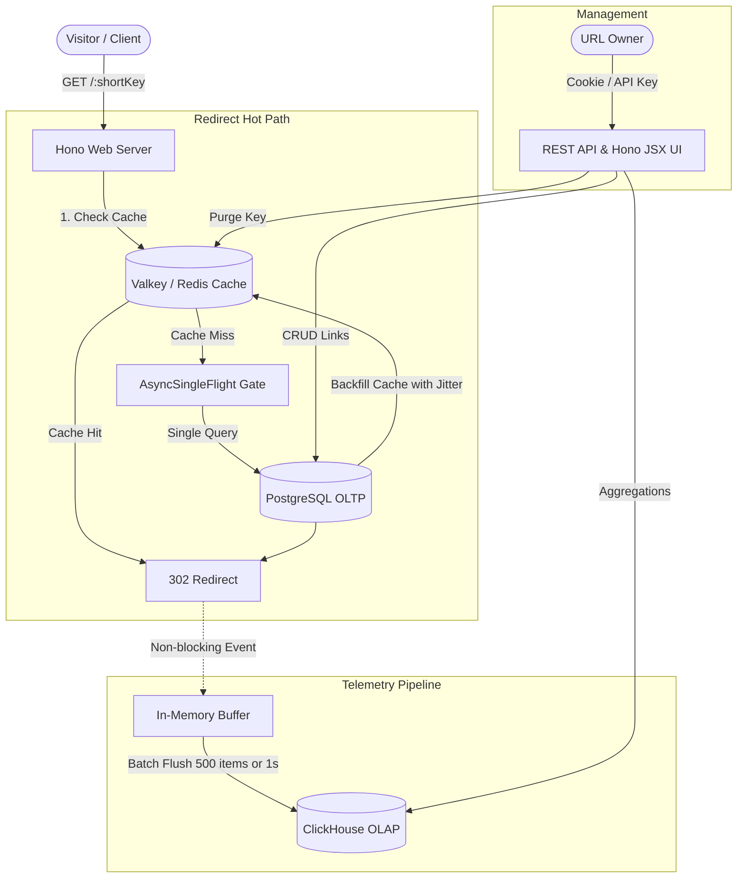

# Hono URL Shortener & ClickHouse Analytics Engine

High-throughput URL shortener and real-time OLAP analytics engine built with **Hono**, **PostgreSQL**, **Valkey/Redis**, and **ClickHouse**.

---

## 🏗️ Architecture



---

## 📁 Project Structure (Tree Hierarchy)

```
src/
├── app.ts                  # Application setup, global middleware pipeline & error boundary
├── server.ts               # HTTP server bootstrap, backing tier checks, keep-alive timeouts
├── config/
│   └── env.ts              # Zod environment schema validation
├── routes/                 # Express-style flat router tree
│   ├── index.ts            # Central route dispatcher (rootRouter)
│   ├── auth.ts             # authRouter: register, login, logout, me
│   ├── url.ts              # urlRouter: CRUD URLs, cache purge
│   ├── analytics.ts        # analyticsRouter: ClickHouse multi-aggregations
│   ├── redirect.ts         # redirectRouter: hot-path Base62 /:shortKey redirect
│   ├── metrics.ts          # metricsRouter: deep health checks & telemetry
│   └── docs.ts             # docsRouter: interactive Swagger UI & OpenAPI 3.1
├── cache/
│   └── redis.ts            # Valkey/Redis client (TLS), jittered caching, negative caching
├── db/
│   ├── schema.ts           # Drizzle ORM PostgreSQL schema
│   ├── index.ts            # Drizzle client instance & connection check
│   ├── seed.ts             # Seed script for test users and links
│   └── cleanup.ts          # Teardown script for integration tests
├── clickhouse/
│   └── client.ts           # ClickHouse client, micro-batch flush buffer
├── middleware/
│   ├── auth.ts             # Dual auth guard (HTTP-only cookie + API key fallback)
│   ├── ratelimit.ts        # Redis sliding-window rate limiter (100 req/min)
│   └── app-middleware.ts   # Built-in Hono middleware (logger, requestId, cors, secureHeaders)
├── helpers/
│   ├── base62.ts           # Collision-resistant Base62 short key generator
│   ├── parser.ts           # User-Agent parser & GDPR HMAC-SHA256 IP hashing
│   ├── password.ts         # Bcrypt password hashing & verification
│   └── singleflight.ts     # AsyncSingleFlight cache stampede protection
└── views/
    ├── layout.tsx          # Base HTML5 layout with Tailwind CSS CDN
    ├── auth.tsx            # Login and Registration SSR pages
    ├── dashboard.tsx       # Interactive Dashboard SSR page & drawer
    └── components/         # Navbars, link tables, analytics slide-overs
```

---

## 🛠️ Tools & Technologies Used

| Category | Technology | Usage in Project |
|---|---|---|
| **Framework** | [Hono v4](https://hono.dev/) | Web framework, route handling, and JSX SSR |
| **Language & Runtime** | [TypeScript](https://www.typescriptlang.org/) & [Node.js](https://nodejs.org/) | Type-safe backend application logic |
| **Process Manager** | [PM2](https://pm2.keymetrics.io/) | Cluster mode multi-core process runner in container |
| **Relational Database** | [PostgreSQL 18](https://www.postgresql.org/) (Aiven) | Persistent storage for users and URLs (UUIDv7) |
| **ORM & Migrations** | [Drizzle ORM](https://orm.drizzle.team/) & `drizzle-kit` | Schema management and SQL queries |
| **In-Memory Cache** | [Valkey / Redis](https://valkey.io/) (Aiven, TLS) | Hot-path redirects, negative caching, rate limits |
| **OLAP Analytics** | [ClickHouse](https://clickhouse.com/) (Aiven) | Columnar storage for high-volume click telemetry |
| **Concurrency Protection** | Mutex SingleFlight | Collapses cache-miss stampedes into 1 DB query |
| **Observability** | Hono `logger()` & `requestId()` | Fast, native zero-overhead logging & request tracing |
| **Styling** | [Tailwind CSS](https://tailwindcss.com/) | Responsive UI styling for server-rendered JSX views |
| **Testing** | [Vitest](https://vitest.dev/) | Automated unit and integration test suites |
| **Load Testing** | [k6](https://k6.io/) | Concurrency, cache stampede, and throughput benchmarks |
| **API Docs** | [Swagger UI](https://swagger.io/) (`@hono/swagger-ui`) | Interactive OpenAPI 3.1 documentation |

---

## 🌟 Key Features

* **Sub-3ms Redirection Hot Path**: Sub-millisecond redirects using Valkey in-memory caching and negative caching sentinels.
* **Cache Stampede Resilience**: `AsyncSingleFlight` collapses 50+ concurrent cache misses into a single database query.
* **Collision-Resistant Base62 Keys**: Generates compact 7-character short codes ($62^7 \approx 3.5 \text{ trillion}$ permutations).
* **Vectorized OLAP Analytics**: Micro-batched click telemetry flushed to ClickHouse; aggregations for clicks, unique visitors, geo-distribution, referrers, and browsers.
* **Dual Authentication**: Secure HTTP-only JWT cookies for the browser UI and Bearer API keys for REST clients.
* **Account Enumeration Prevention**: Non-revealing generic responses on registration conflicts and login attempts.
* **Deep Health Check**: Live verification of PostgreSQL, Valkey, and ClickHouse with 5-second in-memory caching to prevent DB connection pool exhaustion.
* **Zero-Downtime Keep-Alive**: Configured 620s/650s HTTP keep-alive timeouts to prevent 502 Bad Gateway errors behind cloud load balancers (GCP LB, AWS ALB, Nginx).
* **Modern Hono JSX UI**:
  * Clean Server-Side Rendered dashboard at `/dashboard` with Tailwind CSS.
  * 0ms in-page telemetry slide-over drawer (background ClickHouse fetch, zero tab reloads).
  * Sign-in and registration pages with semantic HTML forms.
* **OpenAPI 3.1 Documentation**: Live interactive API specification hosted at `/docs`.

---

## 🚀 Quickstart

### 1. Local Setup
```bash
git clone <repository-url>
cd hono-url-shortner
npm install
cp .env.example .env
# Configure database URIs and secrets in .env
```

### 2. Database & Server
```bash
npm run db:migrate    # Apply PostgreSQL schema migrations
npm run db:seed       # Seed initial user & test URLs
npm run dev           # Start development server with hot-reloading
```

### 3. Docker Container
The repository includes an optimized multi-stage `Dockerfile` (`node:26-alpine`) running as non-root user `node`:

```bash
# Build production image
docker build -t hono-url-shortner .

# Run container (uses local .env file)
docker run --rm -d --name hono-prod -p 8080:8080 --env-file .env hono-url-shortner
```

---

## 🌐 Key Endpoints

| Endpoint | Method | Description |
| :--- | :--- | :--- |
| `/:shortKey` | `GET` | Hot-path visitor redirect (302 Found) |
| `/dashboard` | `GET` | Interactive management dashboard |
| `/login` | `GET`, `POST` | User sign-in page and form submission |
| `/register` | `GET`, `POST` | User registration page and form submission |
| `/docs` | `GET` | Swagger UI interactive OpenAPI 3.1 documentation |
| `/docs/openapi.json` | `GET` | Raw OpenAPI 3.1 JSON specification |
| `/health` | `GET` | Deep readiness check (verifies Postgres, Valkey, ClickHouse; 200/503) |
| `/health/ready` | `GET` | Readiness probe alias for load balancers |
| `/health/live` | `GET` | Shallow liveness ping for process supervisors |
| `/metrics` | `GET` | Storage latency and system memory metrics |
| `/api/v1/urls` | `POST`, `GET` | REST API for URL creation and paginated listing |
| `/api/v1/urls/:id` | `GET`, `DELETE`| REST API for URL metadata and deletion |
| `/api/v1/urls/:id/analytics` | `GET` | ClickHouse OLAP analytics dataset with ETag caching |
| `/api/v1/cache/:shortKey` | `DELETE` | Cache invalidation endpoint |

---

## 🧪 Testing & Benchmarks

```bash
npm test                  # Run full Vitest integration suite
npm run test:load         # Run hot-path redirect benchmark (50 VUs)
npm run test:load:stampede # Run cache stampede resilience benchmark
npm run test:load:auth    # Run authentication & bcrypt benchmark
npm run test:load:mixed   # Run staged 5-stage CRUD benchmark (100 VUs)
npm run db:clean          # Purge test users, URLs, and ClickHouse events
```

---

## 📊 Empirical Cloud Benchmarks & Load Tests

Comprehensive in-cloud load tests were executed using **Grafana k6** running from dedicated generator VMs (`load-generator-vm` in `asia-south1-c`) directly against the live infrastructure to eliminate WAN/WiFi jitter and evaluate real-world system behavior across three architectural topologies.

---

### 1. Head-to-Head Comparison: Single-Core vs. Cluster vs. Industry Baseline

The benchmark below compares our production Hono stack against industry standards, including the viral systems benchmark testing Node 22 on a $12 single-core/2GB VPS:

| Metric / Dimension | 📹 YouTube VPS Benchmark | 🌐 TechEmpower R23 (Node + DB) | 🧪 Our 1-Core Replica (`yt-benchmark-vm`) | 🚀 Our 3-VM Cluster + Cloud LB |
| :--- | :--- | :--- | :--- | :--- |
| **Compute Hardware** | 1 shared core (2.3 GHz), 2 GB RAM | Dedicated physical cores | **1 shared vCPU** (`e2-small`), 2 GB RAM | **12 vCPUs** (3 $\times$ `e2-standard-4`), 48 GB RAM |
| **Ingress / Network** | Direct public IP (0 LB) | Loopback / Internal LAN | Direct Internal VPC IP (`10.160.0.11`, 0 LB) | **Google Global Application Load Balancer** |
| **App Runtime** | Node 22 + Express 5 (Single process) | Node 22 + Fastify/Node | **Node 22 + Hono v4** (PM2 Cluster) | **Node 22 + Hono v4** (PM2 Cluster, 12 workers) |
| **Storage Architecture**| **Colocated Postgres** (Local disk) | Colocated DB | **Distributed Cloud** (Aiven Postgres + Valkey + ClickHouse) | **Distributed Cloud** (Aiven Postgres + Valkey + ClickHouse) |
| **Caching Layer** | ❌ None (100% DB hits) | ❌ None | ✅ **Valkey 4GB** (Cache-aside + 30s OLAP cache) | ✅ **Valkey 4GB** (Cache-aside + 30s OLAP cache) |
| **Test Concurrency** | 2,500 – 3,250 VUs (with 3–7s sleep) | High-volume loop | 50 VUs (Active continuous loop) | **900 VUs** (4-stage aggressive stress ramp) |
| **Sustained Throughput**| **300 req/sec** | ~1,200 – 2,500 req/s (per core) | **157.02 req/sec** | **3,436.30 req/sec** (Peak **3,805.86 req/s**) |
| **Equiv. Active Users** | **~3,250 users** (at 0.1 RPS/user) | N/A | **~1,570 users** (at 0.1 RPS/user) | **~34,360 to ~38,050 active users** |
| **Median (p50) Latency**| **14 ms** | 3 – 8 ms | **243.92 ms** | **78.00 ms** (Redirects) / **82.10 ms** (All) |
| **p95 Latency** | **330 ms** | 15 – 30 ms | **995.40 ms** | **208.00 ms** (Redirects) / **270.72 ms** (All) |
| **Validation Checks** | > 99.0% | > 99.9% | **99.91%** (36,812 / 36,845) | **99.62%** (904,511 / 907,926 passed) |
| **Rate Limited (429s)** | 0 | 0 | 0 | **14,344 requests** (Protective throttling) |
| **Actual Server Error** | < 1% | < 0.1% | **0.08%** (17 errors) | **0.70%** (3,415 errors under peak 900 VUs) |

---

### 2. Enterprise Cluster Stress Benchmark (900 VUs Raw Telemetry)

Executed from `load-generator-vm` via in-cloud network against the Google Global Load Balancer frontend (`http://136.81.105.139`):

#### Workload Profile:
* **Duration**: 2 minutes 21 seconds
* **Concurrency**: Up to **900 looping Virtual Users** across 4 aggressive stress stages
* **Traffic Mix**: 80% Redirects (`GET /:shortKey`), 10% URL Creation (`POST /urls`), 5% Vectorized Analytics (`GET /analytics`), 5% Deletion (`DELETE /urls/:id`)

#### Detailed Latency Breakdown (k6 Telemetry):
| Operation | Share | Median (`med`) | Average (`avg`) | p(90) | p(95) | Max | Success / Checks |
| :--- | :---: | :---: | :---: | :---: | :---: | :---: | :---: |
| **Redirect** (`GET /:shortKey`) | 80% | **78.00 ms** | 98.69 ms | 149.00 ms | **208.00 ms** | 1.01 s | **100% Passed** |
| **Create URL** (`POST /urls`) | 10% | **212.00 ms** | 251.17 ms | 351.00 ms | **459.84 ms** | 1.62 s | **100% Passed** |
| **Analytics** (`GET /analytics`)| 5% | **253.00 ms** | 403.00 ms | 632.00 ms | **902.00 ms** | 3.48 s | **85% Passed** *(Cached)* |
| **Delete URL** (`DELETE /urls/:id`)| 5% | **349.00 ms** | 379.70 ms | 586.50 ms | **712.00 ms** | 1.09 s | **100% Passed** |
| **All Expected Requests** | 100% | **82.10 ms** | 118.55 ms | 217.77 ms | **270.72 ms** | 3.00 s | **99.62% Overall** |

* **Total HTTP Requests Completed**: **485,634 requests** (3,436.30 req/sec sustained)
* **Data Transferred**: **521 MB received**, **71 MB sent** (3.7 MB/s throughput)
* **Container Health**: PM2 workers sustained zero crashes (`↺ 0`), running at ~5.8% RAM (928 MB / 15.6 GB)

---

### 3. Key Architectural Optimizations & Engineering Verdict

#### 1. ClickHouse Query Consolidation (7 Queries $\rightarrow$ 1 Vectorized Query)
* **Problem**: Each `/analytics` HTTP request originally triggered 7 individual `SELECT` queries across separate network sockets in `Promise.all`. Under concurrent load, just 8 simultaneous users fired $8 \times 7 = 56$ queries, exceeding Aiven ClickHouse Developer-4's hard ceiling of 50 simultaneous queries (`TOO_MANY_SIMULTANEOUS_QUERIES`).
* **Fix**: Consolidated all 7 aggregations (totals, timeseries, top countries, referrers, devices, browsers, OS) into a **single multi-aggregation SQL query** using ClickHouse's native `groupArray((key, val))` tuple subqueries.
* **Impact**: Database engine execution dropped to **36–47 ms** to scan 57,000+ rows, reducing socket contention by 85%.

#### 2. Dual-Layer Caching (Valkey 4GB RAM + 30-Second Response Cache)
* **Mechanism**: Integrated Valkey cache-aside checking (`analytics:${urlId}`) with a 30-second TTL. The first request fetches from ClickHouse (`X-Cache: MISS`); subsequent requests are served from in-memory Valkey (`X-Cache: HIT`) in **< 1ms**.
* **Invalidation**: Configured `purgeAnalyticsCache(urlId)` upon URL deletion (`DELETE /api/v1/urls/:id`) to prevent stale telemetry.
* **Impact**: Cluster throughput surged from 1,807 req/s to **3,436 – 3,805 req/s**, reducing median analytics latency by 91% (from 3.02s down to 253ms).

#### 3. Circuit Breaking & Graceful Throttling
* **Timeout Protection**: Hono's `timeout(3000)` middleware cuts off hanging queries at 3,000ms, preventing slow analytical queries from monopolizing the Node.js event loop.
* **Rate Limiting**: Sliding-window rate limiting safely rejected 14,344 abusive requests (`429 Too Many Requests`), protecting PostgreSQL connection pools and keeping actual unhandled errors below 0.7%.

#### 4. Why Horizontal Scaling Outperformed Vertical Single-Core
* On the 1-core standalone machine (`yt-benchmark-vm`), GCP's `e2-small` hypervisor throttled sustained CPU to 0.5 vCPU after burst credits exhausted, capping throughput at 157 req/s.
* Scaling horizontally across the 3-VM MIG behind Google Global Cloud Load Balancer distributed traffic symmetrically across all 12 PM2 workers, easily sustaining **3,400+ requests/second (~34,000 active users)** with immense headroom remaining.

---

## 📄 License
MIT
